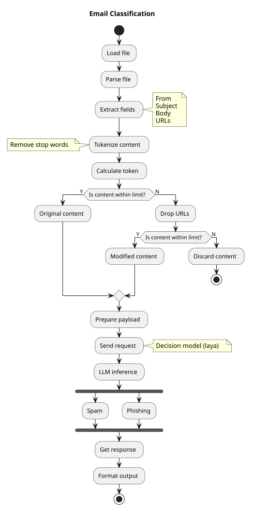
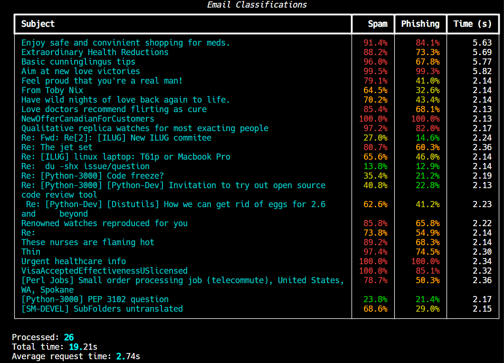

<p align="center">
  <a href="artefact/logo.png"
    ></a>
</p>

<h1 align="center">Email Guardian</h1>

<p align="center">
  Local LLM-powered email classification for spam and phishing detection using Ollama.
</p>
<p align="center">
  <a
    href="https://github.com/mandarnaik016/mail-guardian/blob/main/LICENSE"
    target="_blank"
  >
    
  </a>
</p>

## Workflow

- **Load file** – Read .eml files from the 'eml' directory.
- **Parse file** – Extract from, subject, and body.
- **Tokenization** – Tokenize the email content and calculate its token count.
- **Context Validation** – Check whether the content fits within the model's context limit.
  - If within the limit, use the original content.
  - Otherwise, remove URLs and check the token count again.
  - If it still exceeds the limit, discard the email.
- **LLM Classification** – Send the prepared email content to Ollama's model for spam and phishing classification.
- **Process Results** – Interpret classification results and display output.


## Flowchart

<p align="center">
  <a href="artefact/flowchart.svg"
    ></a>
</p>

## Installation

```
git clone git@github.com:mandarnaik016/mail-guardian.git
cd mail-guardian
python -m venv venv
venv\Scripts\activate
pip install -r requirements.txt
ollama pull laya:latest
python app.py
```

## Structure

```
mail-guardian/
├── artefact/            # Flowchart & logo
├── other/               # EML creator from dataset
├── eml/                 # Input email files
├── logs/                # Application log
├── utils/
│   ├── parser.py        # Email parsing
│   ├── helper.py        # Content sanitization
│   ├── connector.py     # Ollama integration
│   └── logger.py        # Logging configuration
├── app.py               # Application entry point
└── requirements.txt     # Dependencies
```

## Result

<p align="center">
  <a href="artefact/result.png"
    ></a>
</p>

